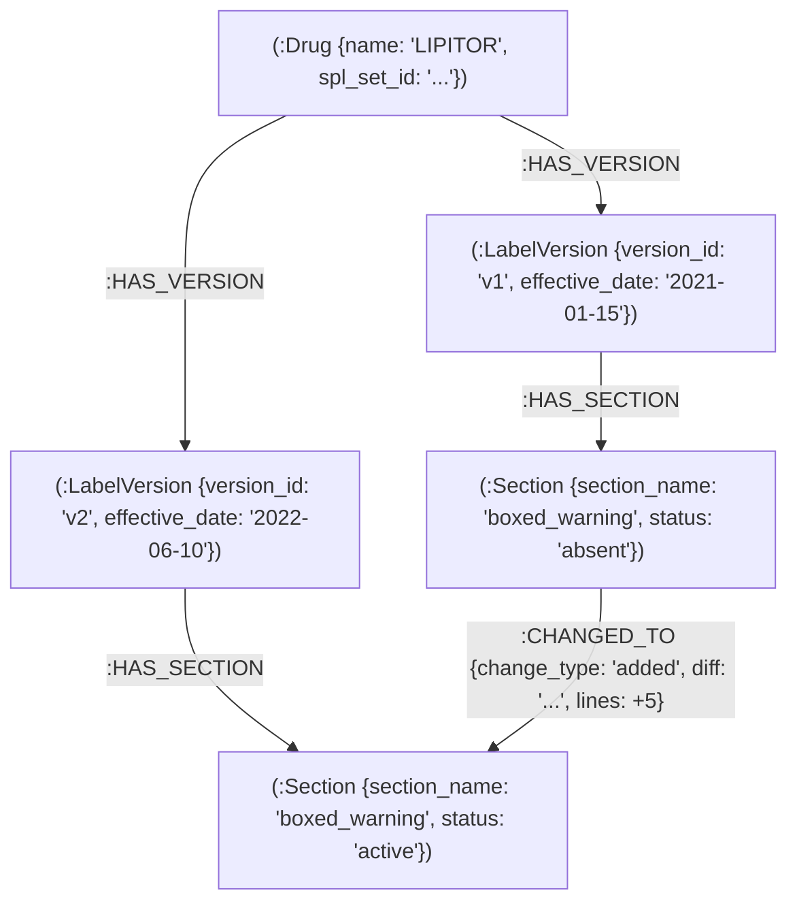

# 📡 LabelRadar: Regulatory Drug Label-Change Intelligence

[](https://github.com/tejaslimaye/LabelRadar/actions)
[](https://www.python.org/downloads/release/python-3120/)
[](https://fastapi.tiangolo.com)
[](https://neo4j.com)
[](https://github.com/pgvector/pgvector)
[](LICENSE)

> **Flagship Intelligence Engine**: Transforming historical FDA drug label revisions into a traversable regulatory knowledge graph. Unlike generic document RAG, LabelRadar tracks the evolution of boxed warnings, indications, contraindications, and dosing across chronological SPL submissions to power commercial and safety forecasting.

---

## 🏗️ Architecture & Graph Schema

LabelRadar ingests structured product labeling (SPL) documents directly from openFDA, preserves each chronological label version with its effective date, computes granular section-by-section diffs, and constructs a specialized regulatory change graph in **Neo4j** backed by dual-persistence in **PostgreSQL + pgvector**.

### Neo4j Graph Topology



- **`(:Drug)`**: Root entity indexed by brand or generic name, linked to stable `spl_set_id`.
- **`(:LabelVersion)`**: Chronological revision identified by `version_id`, ordered by `effective_date`.
- **`(:Section)`**: Granular regulatory section (e.g. `boxed_warning`, `warnings_and_precautions`, `contraindications`).
- **`[:CHANGED_TO]`**: Directed edge between consecutive versions carrying `change_type` (`added`, `removed`, `modified`, `unchanged`), unified diff, line metrics, and similarity ratios.

---

## ⚡ Tech Stack

- **Python 3.12** & **FastAPI (async)**
- **Pydantic v2** & **pydantic-settings**
- **Neo4j** (official `neo4j` async Python driver)
- **PostgreSQL 16 + pgvector** (SQLAlchemy 2.0 async + `asyncpg`)
- **OpenAI-Compatible LLM Client**: Native swapping between local Ollama, MLX (e.g. Qwen 3.5 4B), vLLM, or OpenAI/Groq via environment variables
- **Docker & Docker Compose**: Multi-container stack (`app`, `neo4j`, `postgres` with pgvector)
- **Pytest** with respx and mock suites (zero external network reliance during tests)
- **GitHub Actions**: Automated linting (`ruff`) and testing with services on push

---

## 🚀 Quickstart

### 1. Local Setup with Virtual Environment

```bash
# Clone and enter directory
cd LabelRadar

# Create and activate Python 3.12 venv
python3.12 -m venv venv
source venv/bin/activate

# Install dependencies
pip install --upgrade pip
pip install -r requirements.txt -r requirements-dev.txt

# Copy environment configuration
cp .env.example .env
```

### 2. Run with Docker Compose

Start Neo4j, PostgreSQL with pgvector, and LabelRadar in containers:

```bash
docker compose up --build -d
```

Service endpoints:
- **FastAPI Docs (Swagger UI)**: [http://localhost:8000/docs](http://localhost:8000/docs)
- **FastAPI ReDoc**: [http://localhost:8000/redoc](http://localhost:8000/redoc)
- **Neo4j Browser**: [http://localhost:7474](http://localhost:7474) (User: `neo4j`, Password: `labelradar_password`)
- **PostgreSQL**: `localhost:5432` (`labelradar` / `labelradar_password`)

---

## 🔧 LLM Configuration: Local Ollama / MLX / Remote API

LabelRadar uses standard OpenAI-compatible completions, allowing instant switching between local models and hosted APIs without code modifications.

### Local Ollama / vLLM / Local MLX Server
```bash
OPENAI_BASE_URL=http://localhost:11434/v1
OPENAI_API_KEY=ollama
LLM_MODEL=qwen2.5:latest
```

*For local MLX models (e.g. `~/.cache/huggingface/hub/models--mlx-community--Qwen3.5-4B-8bit`):*
```bash
mlx_lm.server --model ~/.cache/huggingface/hub/models--mlx-community--Qwen3.5-4B-8bit --port 8000
# In .env:
OPENAI_BASE_URL=http://localhost:8000/v1
OPENAI_API_KEY=mlx
LLM_MODEL=default
```

### Cloud OpenAI / Groq / OpenRouter
```bash
OPENAI_BASE_URL=https://api.openai.com/v1
OPENAI_API_KEY=sk-...
LLM_MODEL=gpt-4o-mini
```

---

## 📡 API Reference

### 1. Ingest Drug Labels (`POST /ingest` or `POST /api/v1/ingest`)
Fetches all historical revisions from openFDA, orders them chronologically, computes section-by-section diffs, and constructs the Neo4j graph and PostgreSQL records.

**Request:**
```json
{
  "drug_name": "Lipitor",
  "max_versions": 20
}
```

**Response:**
```json
{
  "success": true,
  "drug_name": "LIPITOR",
  "spl_set_id": "spl-set-lipitor-001",
  "versions_ingested": 3,
  "sections_created": 18,
  "diffs_computed": 4,
  "versions": [
    {
      "version_id": "spl-id-lipitor-v1",
      "version_number": "1",
      "effective_date": "2021-01-15",
      "section_count": 3
    },
    {
      "version_id": "spl-id-lipitor-v2",
      "version_number": "2",
      "effective_date": "2022-06-10",
      "section_count": 4
    }
  ],
  "message": "Successfully ingested 3 versions with 4 section changes."
}
```

---

### 2. Query Change Timeline (`GET /changes` or `GET /api/v1/changes`)
Retrieves the structured timeline of regulatory changes across versions.

**Query Parameters:**
- `drug_name` (*required*): Drug name (e.g. `Lipitor`)
- `section_name` (*optional*): Filter by section (e.g. `boxed_warning`, `contraindications`)
- `change_type` (*optional*): `added`, `removed`, `modified`

**Response:**
```json
{
  "drug_name": "LIPITOR",
  "spl_set_id": "spl-set-lipitor-001",
  "total_versions": 3,
  "total_transitions": 2,
  "total_changes": 4,
  "timeline": [
    {
      "from_version_id": "spl-id-lipitor-v1",
      "to_version_id": "spl-id-lipitor-v2",
      "from_version_number": "1",
      "to_version_number": "2",
      "effective_date": "2022-06-10",
      "changes_count": 2,
      "changes": [
        {
          "section_name": "boxed_warning",
          "change_type": "added",
          "diff": "--- v1/boxed_warning\n+++ v2/boxed_warning\n@@ -0,0 +1,3 @@\n+WARNING: RISK OF IMMUNE-MEDIATED NECROTIZING MYOPATHY...",
          "added_lines": 3,
          "removed_lines": 0,
          "similarity_ratio": 0.0,
          "summary": "Section 'boxed_warning' was newly added (3 lines)."
        }
      ]
    }
  ]
}
```

---

### 3. Health Check (`GET /health` or `GET /api/v1/health`)
Verifies health of the service, Neo4j connectivity, and PostgreSQL database.

**Response:**
```json
{
  "status": "healthy",
  "app": "LabelRadar",
  "environment": "development",
  "databases": {
    "neo4j": "connected",
    "postgres": "connected"
  }
}
```

---

## 🧪 Testing & Linting

Run all unit and integration tests with coverage:

```bash
# Run tests
pytest -v

# Run tests with statement coverage report
pytest -v --cov=app --cov-report=term-missing

# Run Ruff linter
ruff check app tests
```

---

## 🗺️ Flagship Milestones Roadmap

- [x] **Milestone 1**: Ingestion pipeline + section differ + Neo4j graph schema + `/changes` endpoint + Docker + CI
- [ ] **Milestone 2**: Hybrid retrieval API (`/ask`) combining Neo4j graph traversal + pgvector embeddings with version citations
- [ ] **Milestone 3**: Ground-truth evaluation harness (~15 public FDA changes + ~25 multi-hop questions reporting hit@k and answer faithfulness)
- [ ] **Milestone 4**: MCP server wrapper & analyst agent for multi-drug queries
- [ ] **Milestone 5**: Prompt-injection robustness suite inside ingested label text
- [ ] **Milestone 6**: Analyst benchmark report and commercial forecasting analysis

